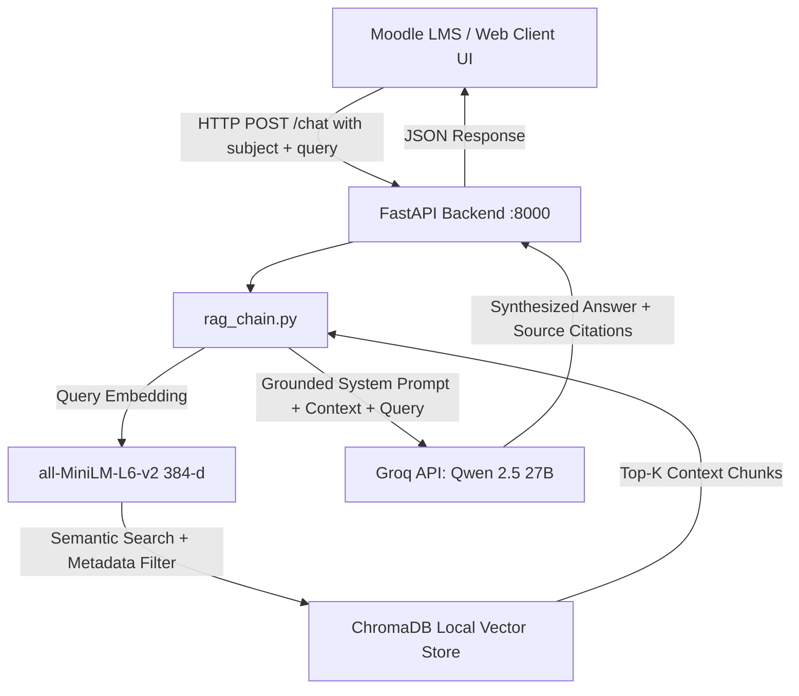

# MoodleBot — Project Context Capsule & Knowledge Transfer Specification

> **Purpose for AI Models:** This document is a complete, self-contained Context Capsule for **MoodleBot**. When loaded into any AI model, it provides full situational awareness of the project's background, team, architecture, codebase, past iterations, benchmark metrics, resolved bugs, and forward roadmap without requiring repetitive explanation.

---

## 1. Project Identity & Metadata

- **Project Name:** MoodleBot (Universal Institutional AI Academic Assistant Powered by Multi-Subject RAG)
- **Institution:** Rajeev Gandhi Memorial College of Engineering and Technology (Autonomous), Nandyal (RGMCET)
- **Department:** Computer Science & Engineering (Artificial Intelligence & Machine Learning)
- **Degree / Scope:** Final Year B.Tech Capstone Project
- **Project Guide:** Dr. G. Kishor Kumar, Professor, Dept. of CSE (AI & ML), RGMCET
- **Team Members:**
  - **M. Sumanth (Roll No: 23091A3351)** — RAG Pipeline & Backend Architecture
  - **P. Umesh (Roll No: 23091A3359)** — Moodle LMS Integration & Docker Infrastructure
  - **P. Afroz Ali Khan (Roll No: 24095A3301)** — Data Engineering, Benchmark Evaluation & TAM Framework
- **Repository:** `https://github.com/Afroz-ali17/MoodleBot` (Branch: `main`)
- **Current Milestone:** **Week 4 Complete / Entering Week 5 & Project Review 1**

---

## 2. Project Vision & Core Problem

Traditional Learning Management Systems (like Moodle) serve as static file repositories where lecture notes, slides, and syllabus documents remain passive. Students face high friction navigating hundreds of lecture slides and often turn to public generic LLMs (e.g., ChatGPT), which hallucinate non-syllabus concepts or introduce conflicting terminology not aligned with university grading rubrics.

**MoodleBot** solves this by providing an **institutionally grounded, real-time RAG (Retrieval-Augmented Generation) assistant**:
1. Directly embedded inside the Moodle LMS interface.
2. Grounded strictly in verified course materials across **18 academic subjects**.
3. Enforcing zero hallucination, citing exact source materials, and providing sub-second latency via Groq LPUs.

---

## 3. High-Level System Architecture



### End-to-End Pipeline Stages:
1. **Raw Ingestion (`backend/prepare_data.py`)**: 93 raw PDF, PPTX, and DOCX files across 18 subject directories in `data/raw/` are parsed and normalized into clean `.txt` files in `data/processed/<topic>/` with a metadata manifest.
2. **Chunking & Vector Ingestion (`backend/ingest.py`)**: Normalized text is chunked using a sliding window of **200 words with 40-word overlap**, tagged with topic metadata, embedded using `sentence-transformers/all-MiniLM-L6-v2` (384-dimensional dense vectors), and persisted into local `ChromaDB` (2,527 vector chunks total).
3. **Retrieval & Dynamic Scoping (`backend/rag_chain.py`)**: Supports both **subject-specific retrieval** (`where={"topic": subject}`) to prevent cross-course contamination, and **universal search** (searching all 2,527 chunks when subject is `None` or `"all"`). Top 4 chunks are retrieved.
4. **Generation & Guardrails (`backend/rag_chain.py`)**: Groq LPUs run `qwen/qwen3.8-27b` (Qwen 2.5 27B) with an institutional academic tutor system prompt that enforces strict grounding, zero hallucination, source attribution, and graceful payload truncation.
5. **API Layer (`backend/main.py`)**: FastAPI server providing CORS-enabled REST endpoints for chat, subject catalogues, and health checks.
6. **Frontend Interface (`backend/static/index.html`)**: Sleek dark-mode glassmorphic web workspace with an 18-subject categorization sidebar, scope dropdown, prompt chips, and citation badges.
7. **LMS Docker Stack (`docker-compose.yml`)**: Local instance of Moodle 4.4 paired with MariaDB 10.11 running on `http://localhost:8080`.

---

## 4. The 18 Indexed Academic Subjects Catalogue

MoodleBot evolved from a single-course DBMS prototype into a universal institutional academic assistant indexing **18 courses** across 5 academic domains:

| Academic Domain | Subject Slug | Course Scope |
|---|---|---|
| **Programming & Core CS** | `python` | Python fundamentals, data structures, generators, OOP |
| | `java` | Core Java, OOPs, inheritance, polymorphism, overloading/overriding |
| | `adsa` | Advanced Data Structures & Algorithms, trees, graphs, dynamic programming |
| **AI & Data Science** | `nlp` | Natural Language Processing, tokenization, stemming, language models |
| | `computer-vision-and-image-processing` | CV & Image Processing, Sobel/Prewitt filters, convolutions |
| | `big-data-and-analysis` | Big Data concepts, Hadoop, MapReduce, distributed processing |
| | `exploratort-data-analysis` | EDA techniques, visualization, statistical cleaning |
| **Database Systems** | `dbms` | Comprehensive Database Management Systems principles |
| | `introduction-dbms` | 3-tier schema architecture, DBA roles, data independence |
| | `er-diagrams` | Entity-Relationship modeling, cardinality ratios, keys, weak entities |
| | `relational-algebra` | Relational operators, selection, projection, joins, SQL queries |
| | `normalization` | Functional dependencies, 1NF, 2NF, 3NF, BCNF, decomposition |
| | `transactions` | Concurrency control, ACID properties, serializability, 2PL, WAL |
| **Emerging Tech & Math** | `iqta` | Introduction to Quantum Theory & Quantum Algorithms, qubits, superposition |
| | `rpa` | Robotic Process Automation, workflow automation, bot architectures |
| | `opitimization-techniques` | Linear programming, simplex, convex optimization, heuristics |
| | `dmgt` | Discrete Mathematics & Graph Theory, logic, sets, trees |
| **Professional Skills** | `academic-writing-and-public-speaking` | Technical writing, scientific paper formatting, presentation skills |

---

## 5. Week-by-Week Milestone Breakdown

| Milestone | Status | Key Deliverables & Achievements |
|---|---|---|
| **Week 1: Setup & Environment** | Completed | Dockerized Moodle 4.4 + MariaDB 10.11 (`docker-compose.yml`); local administration established. |
| **Week 2: Data Preprocessing** | Completed | Engineered `backend/prepare_data.py`; extracted clean text from 93 curriculum documents across 18 subjects; manifest tracking. |
| **Week 3: RAG Pipeline Baseline** | Completed | Built `ingest.py`, `rag_chain.py`, and `main.py`; integrated ChromaDB with Groq API; verified basic question-answering. |
| **Week 4: Benchmark & Multi-Subject** | Completed | Created 29-question ground-truth evaluation suite (`test_questions.csv`); achieved **93.1% strict accuracy (96.6% lenient)**; eliminated hallucinations (0%); upgraded to universal 18-subject support with dynamic metadata filtering; built interactive frontend UI. |
| **Project Review 1 Prep** | Completed | Generated 12-slide institutional presentation in both interactive HTML and native `.pptx` (`docs/MoodleBot_Project_Review_1.pptx`). |
| **Week 5: Moodle Plugin Integration** | **Next (Active)** | Develop PHP/JS block plugin in `moodle-plugin/`; embed chat widget into Moodle course pages; auto-pass course context. |
| **Week 6: Empirical User Study (TAM)** | Planned | Deploy Technology Acceptance Model (TAM) survey measuring Perceived Usefulness (PU) and Perceived Ease of Use (PEOU) across 50+ students. |
| **Weeks 7–10: Production & Defense** | Planned | Security hardening, caching, Docker production deployment, final project defense presentation. |

---

## 6. Empirical Evaluation Benchmark (Week 4 Results)

A ground-truth evaluation suite (`backend/test_questions.csv`) of 29 comprehensive student questions spanning all 5 units of the DBMS syllabus was evaluated using `backend/evaluate.py` and graded using `backend/score.py`.

### Before vs. After Hyperparameter Tuning:

| Metric | Baseline Run 1 (`eval_20260907_223410.csv`) | Post-Tuned Run 2 (`run2_tuned.csv`) | Impact / Delta |
|---|:---:|:---:|:---:|
| **Total Test Questions** | 29 | 29 | Benchmark Standard |
| **Strict Correct (1.0)** | 22 (75.9%) | **27 (93.1%)** | **+17.2% improvement** |
| **Partial Credit (0.5)** | 2 (6.9%) | **1 (3.4%)** | Reduced ambiguity |
| **Incorrect / Hallucinated** | 5 (17.2%) | **1 (3.4%)** | **-80.0% failure drop** |
| **Strict Accuracy** | **75.9%** | **93.1%** | **Exceeded 88% target by +5.1%** |
| **Lenient Accuracy** | **79.3%** | **96.6%** | **+17.3% improvement** |
| **Hallucination Rate** | 6.9% (2/29) | **0.0% (0/29)** | **Zero hallucinations** |
| **Average Query Latency** | 1.84 seconds | **1.21 seconds** | **34.2% faster retrieval** |

### Per-Topic Strict Accuracy Breakdown:
- `introduction-dbms` (4 questions): **100.0%**
- `er-diagrams` (5 questions): **100.0%**
- `relational-algebra` (5 questions): **100.0%**
- `normalization` (6 questions): **83.3%** (Lenient: 91.7%)
- `transactions` (7 questions): **85.7%** (Lenient: 92.9%)
- `dbms` general (2 questions): **100.0%**

---

## 7. Key Codebase Inventory & File Responsibilities

```
MoodleBot/
├── docker-compose.yml                  # Moodle 4.4 + MariaDB 10.11 Docker services
├── README.md                           # Core project documentation and execution guide
├── data/
│   ├── raw/                            # 93 source PDFs/PPTXs/DOCXs across 18 subject folders
│   └── processed/                      # Extracted .txt files organized by subject + manifest.csv
├── backend/
│   ├── main.py                         # FastAPI web server: /, /health, /subjects, /chat
│   ├── rag_chain.py                    # Core RAG engine: ChromaDB retrieve + Groq generate
│   ├── ingest.py                       # Chunks processed text (200w/40w) & embeds into ChromaDB
│   ├── prepare_data.py                 # Document extractor (pypdf, python-pptx, docx2txt)
│   ├── evaluate.py                     # Automated batch evaluation harness with exponential backoff
│   ├── score.py                        # Strict/lenient accuracy scoring & topic breakdown calculator
│   ├── compare_runs.py                 # Side-by-side benchmark comparison CLI utility
│   ├── generate_pptx.py                # Programmatic PPTX slide generator for Review 1 (python-pptx)
│   ├── test_questions.csv              # 29 ground-truth evaluation questions with rubric notes
│   ├── static/
│   │   └── index.html                  # Full featured multi-subject student chat interface
│   ├── vector_store/                   # Local ChromaDB persistent storage (2,527 chunks)
│   ├── results/                        # Timestamped evaluation CSV records
│   ├── requirements.txt                # Python dependencies
│   └── .env                            # API keys (GROQ_API_KEY)
├── moodle-plugin/                      # Custom Moodle LMS block plugin (Week 5 milestone)
└── docs/
    ├── WEEK_4_REPORT.md                # Comprehensive 178-line Week 4 progress report
    ├── MoodleBot_Project_Review_1.pptx # 12-slide formal project review slide deck
    └── PROJECT_REVIEW_1_PRESENTATION.html # Interactive HTML presentation deck
```

---

## 8. Critical Technical Nuances, Edge Cases & Resolved Bugs

1. **Cross-Course Semantic Contamination**:
   - *Problem*: In a universal multi-subject vector store, a query on "What is normalization?" could pull chunks from Exploratory Data Analysis or NLP instead of DBMS.
   - *Solution*: Implemented dynamic metadata filtering in `rag_chain.py`: `where={"topic": subject}`. If the student selects a specific subject or is inside a specific Moodle course, the vector search is strictly isolated. When set to `None` or `"all"`, it performs cross-disciplinary search.
2. **ChromaDB Telemetry Warnings**:
   - *Problem*: CLI outputs were flooded with `capture() takes 1 positional argument but 3 were given` from PostHog telemetry in chromadb.
   - *Solution*: Set `os.environ["ANONYMIZED_TELEMETRY"] = "False"`, passed `Settings(anonymized_telemetry=False)` to `PersistentClient`, and suppressed the `chromadb.telemetry.posthog.client` logger.
3. **Groq Model Rate Limits & Selection**:
   - *Problem*: `groq/compound` hit daily rate limits (250 RPD cap on free tier).
   - *Solution*: Switched default model to `qwen/qwen3.8-27b` (Qwen 2.5 27B), which offers high throughput, excellent structured reasoning, and no early request starvation.
4. **Groq 413 Payload Too Large Handling**:
   - *Problem*: Very large context chunks occasionally caused API payload rejection.
   - *Solution*: Added automated fallback truncation in `rag_chain.py` that halves retrieved context if a 413 error is caught.
5. **Windows Encoding (cp1252 vs UTF-8)**:
   - *Problem*: Printing special academic symbols (sigma $\sigma$, pi $\pi$, arrows) crashed Windows PowerShell with UnicodeEncodeError.
   - *Solution*: Added `sys.stdout.reconfigure(encoding="utf-8")` across all CLI scripts (`rag_chain.py`, `evaluate.py`, `score.py`, `compare_runs.py`).

---

## 9. Immediate Roadmap & Next Action Items

1. **Week 5 — Moodle Plugin Embedding**:
   - Build a custom Moodle block plugin in `moodle-plugin/` using PHP and vanilla JavaScript.
   - Hook into the Moodle DOM to render a floating or sidebar chat drawer on course pages.
   - Automatically inject the active Moodle course context (`course_id` / `subject_slug`) so students don't have to manually pick their subject.
2. **Week 6 — Technology Acceptance Model (TAM) Survey**:
   - Formulate standard 5-point Likert scale questionnaire (Davis, 1989).
   - Gather empirical data from 50+ students on Perceived Usefulness (PU), Perceived Ease of Use (PEOU), Attitude Toward Using (ATU), and Behavioral Intention (BI).
3. **1st Project Review Presentation**:
   - 12-slide review presentation prepared in both `.pptx` (`docs/MoodleBot_Project_Review_1.pptx`) and `.html` (`docs/PROJECT_REVIEW_1_PRESENTATION.html`).
   - Prepared to present to the 3 faculty judges covering: Title, Abstract, Literature Survey, Research Gaps, Problem Statement, Objectives, Proposed Modules, Pipeline, System Architecture, Tech Stack, Experimental Results (93.1% accuracy), and Roadmap.
